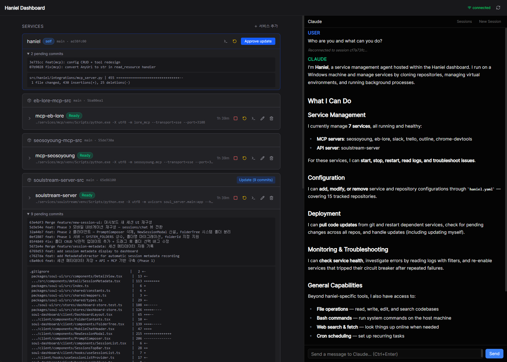

# haniel

**A service runner that your AI agent can operate.**

haniel manages processes, polls git repos, and exposes everything through [MCP](https://modelcontextprotocol.io/) —
so Claude Code can deploy, restart, monitor, and configure your services through natural conversation.

```
You:    "Deploy the latest changes to api-server"
Claude: haniel_pull(repo="api") → haniel_restart(service="api-server")
        ✅ Pulled 3 commits, api-server restarted successfully.
```

<p align="center">
  
</p>

[](https://github.com/eiaserinnys/haniel/actions/workflows/test.yml)

## The problem

You have a few services running on a machine. You want to:
- Deploy by pulling from git, not by building Docker images
- Let your AI agent handle routine ops (restart, rollback, check logs)
- See what's happening from a dashboard

Existing tools don't quite fit:

| Tool | Gap |
|------|-----|
| **PM2 / systemd** | No AI interface. Agent must generate shell commands and parse text output. |
| **Docker Compose** | Assumes containerized workflows. Overkill when you just want to `git pull` and restart. |
| **Coolify / CapRover** | Full PaaS with their own deployment model. You're adopting a platform, not a tool. |

haniel is a **single YAML file** + a process that your AI agent already knows how to talk to.

## How it works

1. **You write `haniel.yaml`** (or let Claude Code do it) — repos to poll, services to run, how they depend on each other
2. **haniel runs as a service** — polls git, manages processes, restarts on crash
3. **Claude Code connects via MCP** — every operation is a tool call, not a shell command

> **For agents**: See [`haniel.yaml.example`](haniel.yaml.example) and [Configuration Reference](docs/configuration.md) for the full schema.

```yaml
# haniel.yaml
poll_interval: 60

# Without these two blocks the MCP server and the dashboard API are not started.
mcp:
  enabled: true
dashboard:
  enabled: true

repos:
  backend:
    url: https://github.com/you/backend.git
    branch: main
    path: ./.services/backend
    release_manifest: deploy/release-manifest.json

services:
  api:
    run: ./.services/backend/.venv/bin/python -m uvicorn app:main --port 8000
    cwd: ./.services/backend
    repo: backend
    ready: port:8000
    ready_timeout: 120
    hooks:
      post_pull: ./.services/backend/.venv/bin/pip install -r requirements.txt
      timeout: 900
```

The `mcp:` block turns on the MCP server (default `127.0.0.1:3200`) and the `dashboard:` block turns on the dashboard and its `/api/*` routes on the same port. Leave the blocks out and neither starts; the log says so and `haniel status` cannot ask the running instance. Paths and hook commands are POSIX style here; on Windows use `Scripts\python.exe` and `Scripts\pip.exe` in the venv.

Haniel watches the repo, pulls changes, runs the build hook, and restarts the service. Repositories with migrations can add a [versioned release manifest](docs/configuration.md#migration-aware-release-manifests) so one approval covers preflight, backup, migration, readiness, verification, and automatic recovery.

## Updates

How a new commit reaches your services:

1. **Polling.** Every `poll_interval` seconds (default 60, counted from the start of one poll to the start of the next) haniel runs `git fetch` on every repo and compares the local HEAD with the remote branch. A poll that takes longer than the interval is followed by the next one at once. A service that crashed is restarted after its backoff or `restart_delay` without waiting for the next poll.
2. **Automatic apply (default).** The global `auto_apply` is `true`, so a detected change is pulled, built (`post_pull` hooks), and the affected services are restarted without asking. "Affected" means every service of that repo plus the services that start after them, so a commit that only touches `README.md` also restarts them. A repo can opt out with `auto_apply: false`; the global `false` turns automatic apply off for all repos. A manifest repo can list paths in `change_ignore_paths` so such commits create no update at all (see [Configuration Reference](docs/configuration.md#migration-aware-release-manifests)).
3. **Approval.** A change that may not apply on its own stays pending. Approve it from the dashboard, with `haniel_pull(repo)` or `haniel_update(service)` over MCP, or, when the node is connected to a Haniel orchestrator (`orchestrator_client`), from the orchestrator's Pending screen in the web hub or the iOS app. The node reports each change to the orchestrator and runs it when the approval arrives; the orchestrator keeps the history of what was approved, rejected, or failed. The local routes work with or without an orchestrator.
4. **Self-update.** A change in haniel's own repo (the `self:` block) always waits for approval unless `self.auto_update` is `true`; the global `auto_apply` does not change that. Approving it restarts the Haniel process, so **every service on this node stops for a moment**. Services that the release manifest declares `overlap` or `adopt` stay up. Other repos' pending changes are not part of it: approve them again once Haniel is back. The hub handles a pending self-update first and refuses other approvals for the node until it is approved or postponed.

The same warning applies to `haniel_restart(service="haniel")` and to pulling haniel's own repo with `haniel_pull`: both restart the Haniel process (see [Self-update](#self-update)).

## Features

- **Git polling** — watches repositories, pulls on new commits
- **Process management** — start, stop, restart with dependency ordering
- **Lifecycle hooks** — `pre_start` and `post_pull` for prerequisites and builds
- **Migration-aware releases** — versioned manifests with backup gates, readiness verification, and automatic recovery
- **Health monitoring** — crash detection, exponential backoff, circuit breaker
- **MCP server** — full control surface via Streamable HTTP
- **Web dashboard** — real-time service and repository status UI
- **Runtime config** — add/update/remove services without restart
- **Self-update** — two-loop architecture for updating its own code
- **Webhooks** — Slack, Discord, or JSON on deploys and failures

## Quick start

Haniel needs Python 3.11 or newer and git on every OS. Node, pnpm, and Claude Code are
needed only when your services or the install steps use them: `haniel install` checks for
Claude Code only when its interactive step has values to collect, and
`haniel install --skip-interactive` never needs it.

PyPI has no `haniel` package. Install it from GitHub:

```bash
pip install git+https://github.com/eiaserinnys/haniel.git
```

### Install on Windows

Windows 10 or later, PowerShell 5.1+ as Administrator, and `winget` if you want the script to
install Git, Python, and Node.js for you.

```powershell
irm https://raw.githubusercontent.com/eiaserinnys/haniel/main/install-haniel.ps1 | iex
```

The script asks for the install folder (default `C:\Services\Haniel`), checks or installs Git,
Python, and Node.js, downloads WinSW into `bin\`, clones haniel into `.self\`, creates
`.self\.venv`, and installs haniel there. It then asks for the config source, an HTTPS URL or a
local file path, copies it to `<root>\haniel.yaml`, runs `haniel install haniel.yaml`, and starts the
service with `sc start`. To skip the questions, download the script and pass a prepared
`haniel.yaml`:

```powershell
irm https://raw.githubusercontent.com/eiaserinnys/haniel/main/install-haniel.ps1 -OutFile install-haniel.ps1
.\install-haniel.ps1 -InstallPath "D:\Services\Haniel" -ConfigUrl "C:\prepared\haniel.yaml"
```

`-ConfigUrl` takes an HTTPS URL or a local path. `-SkipGitCheck`, `-SkipPythonCheck`, and
`-SkipNodeCheck` skip the matching prerequisite check. Afterwards manage the service with
`sc start haniel`, `sc stop haniel`, and `sc query haniel` (use the name from `install.service.name`).
Logs are in `<root>\logs\`. Windows venv paths in `haniel.yaml` end in `Scripts\python.exe` and
`Scripts\pip.exe`.

### Install on Linux

You need Python 3.11+, git, and systemd for the service. Install haniel into a virtual
environment, put a `haniel.yaml` in the folder you want to use as the root (start from
[`haniel.yaml.example`](haniel.yaml.example)), check it, and run it:

```bash
python3 -m venv ~/haniel-venv
~/haniel-venv/bin/pip install git+https://github.com/eiaserinnys/haniel.git
export PATH="$HOME/haniel-venv/bin:$PATH"

mkdir -p ~/haniel-root && cd ~/haniel-root
cp /path/to/haniel.yaml.example haniel.yaml     # then edit it
haniel validate haniel.yaml
haniel run haniel.yaml                          # Ctrl+C stops it
```

`haniel run` clones a repo whose `path` does not exist yet, so a config with only `repos` and
`services` is enough to start. A failed clone logs an error with the repo name and URL, and the
services of that repo fail to start until the path exists.

To build the whole environment (directories, clones, venvs, config files) and register a systemd
service, add an `install:` block (see the example) and run `haniel install`:

```bash
haniel install --dry-run haniel.yaml          # show the plan
sudo env "PATH=$PATH" haniel install haniel.yaml
sudo systemctl start haniel                   # the name is install.service.name
```

Writing `/etc/systemd/system/<name>.service` needs root; without permission the installer prints
the unit text and the commands to run by hand. Registration runs `systemctl daemon-reload` and
`systemctl enable`, but never `start`. The unit runs as the user who invoked `sudo` (or the
installing user when not using `sudo`), so files that the installer created as root, such as the
clones and venvs, must be handed to that user (`sudo chown -R "$USER": ~/haniel-root`) before the
first start.

- **With a `self:` block** the unit's `ExecStart` is `/bin/bash <self repo>/haniel-runner.sh <root>/haniel-runner.conf`.
  The installer writes `haniel-runner.conf`, and stops before writing the unit if the wrapper
  script or its release helper is missing from the self repo checkout. The wrapper uses
  `<self repo>/.venv/bin/python`, or `python3` from `PATH`. Without it an approved self-update could
  not pull and relaunch (see [Self-update](#self-update)).
- **Without a `self:` block** the unit runs `haniel run haniel.yaml` directly.
- Haniel's own log is `<root>/logs/haniel.log`; its console output goes to
  `journalctl -u haniel`.
- With `--skip-interactive` the installer collects no values and Claude Code is not required. Use
  it when every key in `install.configs` has a `default`: a key without one stops the final step
  with "Not all required configs are filled". Re-running over an existing `install.state` needs
  `--state-policy resume` or `--state-policy start-fresh` whenever it cannot ask you (with
  `--skip-interactive` or without a terminal).

### Install on macOS

Install Python 3.11 or newer and git first, plus Node, pnpm or Claude Code
when the services need them. There is no automatic tool installer. Install
Haniel into the virtual environment of the Python you choose:

```bash
python3 -m venv ~/.local/haniel-venv
~/.local/haniel-venv/bin/pip install git+https://github.com/eiaserinnys/haniel.git
```

Homebrew lives in `/opt/homebrew/bin` on Apple Silicon and in `/usr/local/bin`
on Intel Macs. The installer and the generated LaunchAgent append these
directories to the tool search PATH, but tools are never installed
automatically.

`haniel.yaml.example` already uses POSIX venv paths such as `./runtime/venv/bin/pip`, which also
suit macOS service hooks. The shared hook runner does not translate Windows paths.

Service registration installs a user LaunchAgent at
`~/Library/LaunchAgents/com.haniel.<name>.plist`. It is not loaded during
installation; after logging in as the same user, start and manage it with:

```bash
launchctl bootstrap gui/$(id -u) ~/Library/LaunchAgents/com.haniel.runner.plist
launchctl print gui/$(id -u)/com.haniel.runner
launchctl kickstart -k gui/$(id -u)/com.haniel.runner
launchctl bootout gui/$(id -u)/com.haniel.runner
```

With self-update enabled the agent runs `haniel-runner.sh` from the Haniel
repo, which prepares a release and relaunches on exit codes 10 and 11.

### Command line

`haniel` has four commands. Service control (start, stop, restart, pull) is not in the CLI; use
MCP or the dashboard.

| Command | What it does |
|---|---|
| `haniel install [CONFIG]` | Builds the environment described in `CONFIG`'s `install:` block. `--dry-run` shows the plan, `--skip-interactive` skips the Claude Code step, `--state-policy resume\|start-fresh` picks what to do with an existing `install.state` (`--resume` is the old name for `resume`). Without `CONFIG` it prints help. |
| `haniel run [CONFIG]` | Starts the services and enters the poll loop. Without `CONFIG` it uses `./haniel.yaml` and exits with code 2 when that file is missing. A second `haniel run` for the same config prints one line and exits with code 1. `--dry-run` prints the plan, `--log-level` sets the level. Exit codes the service wrapper reads: 10 for an approved self-update, 11 for a restart request. |
| `haniel status [CONFIG]` | Prints `Running (pid N)` or `Not running` from the instance that owns this config, then asks that instance for its real service and repo state. `--json` prints JSON. |
| `haniel validate [CONFIG]` | Checks the file and exits 1 when it finds an error. `--no-plain-secrets` also rejects plain-text secrets. |

`haniel status` asks `http://<mcp.host>:<mcp.port>/api/status`, so the config needs both
`mcp.enabled: true` and `dashboard.enabled: true`, and it sends `dashboard.token` as a Bearer token
when one is set. When it cannot ask (a block is missing, the connection fails, the token is
rejected) it says why and lists only the services and repos from the config, marked "not runtime
state"; it never prints a state it does not know.

`haniel validate` catches unknown keys (a misspelled `redy` or a top-level `serivces`, with a "did you
mean" hint), an unusable `ready` (`prt:80`), an unknown `shutdown.signal`, a negative `restart_delay`
or `backoff` delay, an empty repo `url` or orchestrator `url`/`token`, plus broken `after` or repo
references, `after` cycles, and port conflicts. A file with no services passes with a warning.
Saving a service or repo through MCP or the REST API rejects that entry for the same problems, while
`haniel run` only logs them as warnings and starts anyway.

Logs: every service's stdout and stderr go to `<folder of haniel.yaml>/logs/<service>.log`, and
Haniel's own log to `<folder of haniel.yaml>/logs/haniel.log`. Over MCP use `haniel_read_logs`.

### Connect Claude Code

The MCP server needs the `mcp:` block (see [How it works](#how-it-works)).

```json
{
  "mcpServers": {
    "haniel": {
      "type": "http",
      "url": "http://localhost:3200/mcp/"
    }
  }
}
```

For connections from another computer when `dashboard.token` is set, add `"headers": {"Authorization": "Bearer ${HANIEL_MCP_TOKEN}"}` to the `haniel` entry and supply `HANIEL_MCP_TOKEN` in the client environment.

Now Claude Code can operate your infrastructure:

```
"What services are running?"          → haniel://status
"Show me api-server logs"             → haniel_read_logs(service="api-server")
"Restart the worker"                  → haniel_restart(service="worker")
"Pull and deploy backend"             → haniel_update(service="api")
"Add a new service"                   → haniel_create_service_config(...)
```

What the tools answer matches what happened:

- `haniel_pull` and `haniel_update` say one of `<name>: pulled; affected services restarted`, `<name>: no changes to pull`, `<name>: already pulling; this request was ignored`, or `<name>: self-update requested`. With no pending changes nothing is pulled or restarted.
- `haniel_enable` undoes `haniel_disable`: it sets `enabled: true` in `haniel.yaml`, resets the circuit breaker, and starts the service. `haniel_reset_circuit` only resets the circuit breaker (see [Configuration Reference](docs/configuration.md#backoff)).
- Naming an unknown service or repo, or a rejected config change, comes back as an MCP error result (`isError`), not as a success message. `haniel_read_logs` on an unknown service is an error too.
- **`haniel_restart(service="haniel")`, `haniel_update(service="haniel")`, and `haniel_pull` on haniel's own repo restart the Haniel process itself.** Every service on this node stops for a moment; services that the release manifest declares `overlap` or `adopt` stay up.
- Saving config through a tool or the REST API rewrites the whole `haniel.yaml` from the loaded configuration. Comments, and keys the loader does not know in other entries, are lost, and defaults are written out; the previous file is kept as `haniel.yaml.bak`.

## Self-update

haniel solves the "surgeon can't operate on themselves" problem with a two-loop design:

```
WinSW (Windows service) / systemd (Linux) / LaunchAgent (macOS)
  └── haniel-runner.ps1 / haniel-runner.sh  (outer loop — survives updates)
       └── haniel run                       (inner loop — the actual service)
```

When an approved self-update is requested, haniel stops its services and exits with code 10.
The outer loop prepares a release for the new commit (its own venv and checkout), switches
the active release, and relaunches. `haniel_restart(service="haniel")` exits with code 11 and the
outer loop relaunches without updating. Either way the services on this node stop for a moment.
A self-update waits for approval by default (see [Updates](#updates)). On Linux the systemd unit
runs the wrapper only when the config has a `self:` block.

## Documentation

- [Configuration Reference](docs/configuration.md)
- [Specifications](docs/specifications.md)
- [ADR-0001: WinSW over NSSM](docs/adr/0001-winsw-over-nssm.md)
- [ADR-0002: Self-update architecture](docs/adr/0002-self-update-architecture.md)
- [ADR-0003: Directory structure](docs/adr/0003-directory-structure.md)

## Development

```bash
git clone https://github.com/eiaserinnys/haniel.git
cd haniel
pip install -e ".[dev]"
pytest
```

Dashboard frontend (React):

```bash
cd dashboard
pnpm install && pnpm run build
```

## License

MIT
